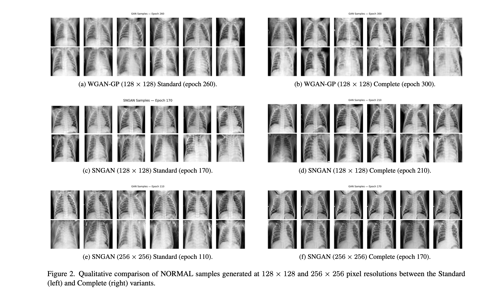

# Generative Adversarial Networks for Data Augmentation and Domain Adaptation in Medical Imaging

[](https://www.python.org/)
[](https://pytorch.org/)
[](https://wandb.ai/)
[](LICENSE)
[](GANs_for_DA%26DA.pdf)

An end-to-end deep learning framework investigating **Generative Data Augmentation (cWGAN-GP, cSNGAN)** and **Adversarial Domain Adaptation (DANN, CDAN+E)** to address severe class imbalance and domain shift in pediatric Chest X-Ray classification (Normal vs. Pneumonia).

<p align="center">
  
</p>

<p align="center">
  <a href="GANs_for_DA%26DA.pdf">📄 <strong>Download the Full Paper (PDF)</strong></a>
</p>

---

## Table of Contents
- [Overview](#overview)
- [Repository Structure](#repository-structure)
- [Key Methodology](#key-methodology)
- [Dataset & Repartitioning](#dataset--repartitioning)
- [Installation](#installation)
- [Quickstart & Usage](#quickstart--usage)
  - [1. Data Augmentation Pipelines](#1-data-augmentation-pipelines)
  - [2. Baselines & Classical Augmentation](#2-baselines--classical-augmentation)
  - [3. Domain Adaptation Pipelines](#3-domain-adaptation-pipelines)
  - [4. Evaluation & Diagnostic Tools](#4-evaluation--diagnostic-tools)
- [Ablation Study Matrix](#ablation-study-matrix)
- [Interpretability & Evaluation Metrics](#interpretability--evaluation-metrics)
- [License](#license)

---

## Overview

Medical image classification often suffers from severe **class imbalance** and **cross-domain distribution shifts**. In pediatric chest radiography, Normal cases are significantly rarer than pathological cases. 

This repository provides an empirical study comparing:
1. **Classical vs. Generative Augmentation**: Comparing clinically valid affine augmentations with high-fidelity synthetic images generated via conditional WGAN-GP and Spectral Normalization GAN (SNGAN).
2. **PatchGAN & BAGAN-like Balancing**: Employing a multi-scale PatchGAN critic to preserve high-frequency pulmonary textures and class-balanced generator sampling.
3. **Synthetic-to-Real Domain Adaptation**: Mitigating the synthetic domain gap identified via PCA/UMAP using Domain-Adversarial Neural Networks (DANN) and Conditional Domain Adaptation (CDAN+E).
4. **Cross-Hospital Unsupervised Adaptation**: Aligning feature distributions between the Kermany pediatric dataset and the external VinDr-PCXR dataset.

---

## Repository Structure

```
GANs-for-DataAugmentation-and-DomainAdaptation/
├── config.py                          # Centralized hyperparameter and path configuration
├── requirements.txt                   # Environment dependencies
├── Proposal_v2.md                     # Research proposal & theoretical documentation
├── README.md                          # Project documentation
│
├── dataset/                           # Data loading, stratification and processing
│   ├── loader.py                      # Core train/val/test split and GAN dataloaders
│   ├── dann_loader.py                 # Cross-hospital domain adaptation loaders
│   ├── synth_real_loader.py           # Combined synthetic + real dataloaders
│   ├── create_modified_dataset.py     # Script to build stratified splits
│   ├── create_dataset_NIH.ipynb       # NIH dataset processing notebook
│   └── create_dataset_VINDR.ipynb     # VinDr-PCXR dataset processing notebook
│
├── models/                            # Neural network architectures
│   ├── resnet.py                      # ResNet-18 classifier (ImageNet pretrained backbone)
│   ├── wgan.py                        # cDC-WGAN-GP Generator & Critic
│   ├── sngan.py                       # Conditional SNGAN (standard 128x128 / 256x256)
│   ├── sngan_128.py                   # SNGAN-128 with PatchGAN critic & Spectral Norm
│   ├── dann.py                        # Standard DANN architecture with GRL
│   ├── dann_synth.py                  # DANN for Synth-to-Real adaptation
│   └── cdan_synth.py                  # CDAN+E (Entropy-conditioned domain discriminator)
│
├── training/                          # Core training loops
│   ├── train.py                       # ResNet, WGAN-GP, and SNGAN training routines
│   ├── train_dann_synth.py            # DANN Synth->Real training loop
│   └── train_cdan_synth.py            # CDAN+E Synth->Real training loop
│
├── experiments/                       # Executable experiment entry points
│   ├── run_wgan_pipeline.py           # WGAN-GP generation + ResNet augmentation
│   ├── run_sngan_pipeline.py          # SNGAN generation + ResNet augmentation
│   ├── run_baselines.py               # Class weighting and random oversampling
│   ├── run_classical_aug.py           # Clinically plausible affine augmentations
│   ├── run_ablation_study.py          # Systematic ablation over GAN types and gap %
│   ├── run_dann_synth.py              # DANN Synth->Real domain adaptation
│   ├── run_cdan_synth.py              # CDAN+E Synth->Real domain adaptation
│   └── run_dann_cross_hospital.py     # Kermany -> VinDr-PCXR unsupervised DANN
│
├── evaluation/                        # Evaluation, diagnostic, and visualization tools
│   ├── evaluate.py                    # Test set evaluation, metrics, and synthesis utility
│   ├── eval_gradcam.py                # Grad-CAM interpretability heatmaps
│   ├── eval_roc_pr.py                 # ROC and Precision-Recall curve generation
│   ├── eval_fidelity.py               # Generative quality metrics (FID & KID via torch-fidelity)
│   ├── eval_dann_comparison.py        # Macro F1 comparison: Pre-DANN vs. Post-DANN
│   ├── eval_dann_test.py              # DANN evaluation suite on target test set
│   ├── eval_f1.py                     # Checkpoint evaluation script for ResNet
│   ├── eval_f1_dann.py                # Standalone F1 evaluator for DANN checkpoints
│   ├── eval_f1_resnet.py              # Standalone F1 evaluator for ResNet checkpoints
│   └── umap_analysis.py               # Feature extraction and UMAP latent visualization
│
├── data/                              # Dataset root (ignored by git, contains .gitkeep)
├── checkpoints/                       # Model weight checkpoints (contains .gitkeep)
└── results/                           # Plots, confusion matrices, and metrics logs
```

---

## Key Methodology

### 1. Conditional GANs with PatchGAN Critic
- **Conditional DC-WGAN-GP**: Trained with Wasserstein distance, gradient penalty ($\lambda = 10$), and an $\epsilon$-drift penalty on the critic.
- **Conditional SNGAN**: Uses spectral normalization across all discriminator layers and Hinge adversarial loss.
- **PatchGAN Discriminator**: Outputs a $16 \times 16$ spatial receptive grid instead of a single scalar, enforcing anatomical consistency and realistic rib/lung high-frequency textures.
- **BAGAN-like Balancing**: The Generator outputs balanced batches (50% NORMAL, 50% PNEUMONIA) while the Discriminator learns from the true imbalanced empirical distribution.

### 2. Domain-Adversarial Neural Networks (DANN & CDAN+E)
Even high-quality synthetic images exhibit residual distribution gaps (*Synthetic Domain Shift*). We employ adversarial domain adaptation:
- **Feature Extractor ($G_f$)**: ResNet-18 backbone (partial fine-tuning of `layer3` and `layer4`).
- **Label Predictor ($G_y$)**: Binary classification head for Normal vs. Pneumonia.
- **Domain Discriminator ($G_d$)**: Distinguishes real from synthetic samples.
- **Gradient Reversal Layer (GRL)**: Inverts gradients during backpropagation with a sigmoidal schedule $\lambda_p = \frac{2}{1 + \exp(-10p)} - 1$, enforcing domain-invariant representations.
- **CDAN+E**: Conditions the domain discriminator on the multilinear interaction between feature representations and classifier predictions, weighted by entropy $w(H) = 1 + e^{-H(p)}$.

---

## Dataset & Repartitioning

Experiments are evaluated on the [Kaggle Chest X-Ray (Pneumonia)](https://www.kaggle.com/datasets/paultimothymooney/chest-xray-pneumonia) dataset. The original validation split contained only 16 images (8 per class). We constructed a stratified split:

| Class | Original Train | Repartitioned Train | Validation (10%) | Test (Unchanged) | Total |
|---|---|---|---|---|---|
| **NORMAL** | 1,341 | 1,145 | 205 | 234 | 1,584 |
| **PNEUMONIA** | 3,875 | 3,502 | 380 | 390 | 4,272 |
| **Total** | 5,216 | **4,647** (79.35%) | **585** (9.99%) | **624** (10.66%) | **5,856** |

The resulting imbalance in the training set is **~1:3**, leaving a gap of **2,357 images** to be augmented for the minority class.

---

## Installation

1. **Clone the repository:**
   ```bash
   git clone https://github.com/mario898-dev/GANs-for-DataAugmentation-and-DomainAdaptation.git
   cd GANs-for-DataAugmentation-and-DomainAdaptation
   ```

2. **Create and activate a virtual environment:**
   ```bash
   python3 -m venv venv
   source venv/bin/activate
   ```

3. **Install dependencies:**
   ```bash
   pip install -r requirements.txt
   ```

4. **Prepare the dataset:**
   Place the dataset into `./data/chest_xray/` or configure the path in `config.py`. To repartition the dataset:
   ```bash
   python dataset/create_modified_dataset.py
   ```

---

## Quickstart & Usage

All pipeline entry points are located in `experiments/` and can be executed directly:

### 1. Data Augmentation Pipelines
- **WGAN-GP Pipeline** (Train WGAN-GP, synthesize minority class, train augmented ResNet):
  ```bash
  python experiments/run_wgan_pipeline.py
  ```
- **SNGAN Pipeline** (Train SNGAN-128 with PatchGAN, generate synthetic samples, train ResNet):
  ```bash
  python experiments/run_sngan_pipeline.py
  ```

### 2. Baselines & Classical Augmentation
- **Baseline Models** (Class Weighting and Random Oversampling):
  ```bash
  python experiments/run_baselines.py
  ```
- **Clinically Plausible Affine Augmentations** (Slight rotation $\pm 5^\circ$, translation $\pm 5\%$, uniform scale $0.95-1.05$):
  ```bash
  python experiments/run_classical_aug.py
  ```
- **Systematic Ablation Study** (Varying gap percentage 25%, 50%, 75%, 100%):
  ```bash
  python experiments/run_ablation_study.py
  ```

### 3. Domain Adaptation Pipelines
- **DANN Synthetic-to-Real Adaptation**:
  ```bash
  python experiments/run_dann_synth.py
  ```
- **CDAN+E Synthetic-to-Real Adaptation**:
  ```bash
  python experiments/run_cdan_synth.py
  ```
- **Cross-Hospital Adaptation (Kermany $\rightarrow$ VinDr-PCXR)**:
  ```bash
  python experiments/run_dann_cross_hospital.py
  ```

### 4. Evaluation & Diagnostic Tools
- **Generative Fidelity (FID & KID)**:
  ```bash
  python evaluation/eval_fidelity.py
  ```
- **Grad-CAM Saliency Maps**:
  ```bash
  python evaluation/eval_gradcam.py
  ```
- **ROC and Precision-Recall Curves**:
  ```bash
  python evaluation/eval_roc_pr.py
  ```
- **Latent Space UMAP Analysis**:
  ```bash
  python evaluation/umap_analysis.py
  ```
- **Pre vs. Post DANN Comparison**:
  ```bash
  python evaluation/eval_dann_comparison.py
  ```

---

## Ablation Study Matrix

The repository evaluates 6 generative configurations across 4 augmentation levels:

| Model Architecture | Resolution | Discriminator Type | Generator Balancing | Augmentation Levels Tested |
|---|---|---|---|---|
| **WGAN-GP** | $128 \times 128$ | Standard DCGAN Critic | Imbalanced | 25%, 50%, 75%, 100% gap |
| **WGAN-GP** | $128 \times 128$ | PatchGAN ($16 \times 16$) | BAGAN (50/50) | 25%, 50%, 75%, 100% gap |
| **SNGAN** | $128 \times 128$ | Standard SN-Critic | Imbalanced | 25%, 50%, 75%, 100% gap |
| **SNGAN** | $128 \times 128$ | PatchGAN ($16 \times 16$) | BAGAN (50/50) | 25%, 50%, 75%, 100% gap |
| **SNGAN** | $256 \times 256$ | Standard SN-Critic | Imbalanced | 25%, 50%, 75%, 100% gap |
| **SNGAN** | $256 \times 256$ | PatchGAN ($16 \times 16$) | BAGAN (50/50) | 25%, 50%, 75%, 100% gap |

---

## Interpretability & Evaluation Metrics

- **Macro F1-Score**: Primary classification metric ensuring equal weighting across classes despite dataset imbalance.
- **Accuracy, Precision, Recall & Confusion Matrices**: Detailed breakdown of false negative vs false positive trade-offs.
- **FID / KID**: Quantitative assessment of synthetic sample distribution fidelity.
- **PCA / t-SNE / UMAP**: 512-dimensional feature space inspection from ResNet-18 `avgpool` layer.
- **Grad-CAM**: Class-activation visual grounding highlighting regions determining pneumonia detection.

---

## License

This project is licensed under the MIT License - see the [LICENSE](LICENSE) file for details.